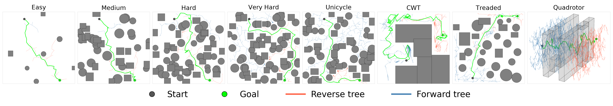

# BBoE: Bidirectional Bundle of Edges

Code, edge bundles, benchmark scripts and logs for

> **BBoE: Leveraging Bundle of Edges for Kinodynamic Bidirectional Motion Planning**
> Srikrishna Bangalore Raghu and Alessandro Roncone
> *IEEE Robotics and Automation Letters (RA-L), 2026*

Project page: https://brsrikrishna.github.io/BBoE_RAL/



BBoE is a bidirectional, kinodynamic, sampling-based motion planner. Instead of generating motions online, it reuses a precomputed *bundle of edges* (short, dynamically feasible motions) and selects which edges to propagate with a sort-and-skip strategy, so that scarce solutions in cluttered environments are found quickly. Across a unicycle, a treaded vehicle, a car with trailer and a 6D quadrotor, BBoE is the only evaluated planner with at least 96% success on every system while attaining the lowest planning time on three of the four. Every number in the paper can be regenerated with the scripts in this repository.

## Contents

| Path | What it is |
|---|---|
| `src/` | The planners and their shared machinery: `bboe.py` (BBoE), `gbrrt.py`, `rrt.py`, `sst.py`, `BoE.py`, `db_rrt.py` / `db_rrt_c.py` (search component of dB-RRT-F / dB-RRT-C); `edge_bundle.py` (bundle loading and generation); `Agents/` (unicycle, treaded vehicle, car with trailer, quadrotor dynamics); `kd_tree_*.py` (neighbor indexes over the kinodynamic components); `Environments.py`, `utils.py`, `printer.py` (animation). |
| `edge_bundles/` | The five bundles used in the paper (see below). |
| `trial_scripts/` | One script per experiment in the paper, plus the figure and animation scripts. |
| `benchmark_logs/` | The logs behind Tables II and III and Figs. 5 and 6, exactly as reported. |
| `media/seed50_plots/` | The plots and tables generated from those logs. |
| `tools/` | Bundle generation and log summarization. |

## Installation

Python 3.8 or newer. The only hard dependencies are NumPy, Numba, SciPy, NetworkX and Matplotlib (Pillow for animations):

```bash
pip install -r requirements.txt
```

The results in the paper were produced with Python 3.8.10, NumPy 1.24.4, Numba 0.58.1, SciPy 1.10.1, NetworkX 3.1 and Matplotlib 3.7.5 on an Intel Core i7-7700HQ (2.8 GHz) laptop with 32 GB of RAM. All scripts resolve paths relative to their own location, so they can be run from any working directory. The first run of each script spends 20 to 60 s compiling Numba kernels; every benchmark script warms up the compiler before the timed trials.

## Reproducing the paper

`./reproduce_all.sh` runs everything below in sequence (about 1.5 hours). The individual steps:

All benchmarks use 50 fixed seeds and a 5 s wall-clock planning budget per trial, after which a trial counts as a failure. Each script prints one line per planner and trial; redirect it to a file to get a log in the same format as the shipped ones. Runtimes below are for the reference laptop.

| Result | Command | Runtime |
|---|---|---|
| Table II and Fig. 5, unicycle | `python trial_scripts/compare_unicycle.py > benchmark_logs/unicycle.log` | 9 min |
| Table II and Fig. 5, treaded vehicle | `python trial_scripts/compare_treaded.py > benchmark_logs/treaded.log` | 13 min |
| Table II and Fig. 5, car with trailer | `python trial_scripts/compare_car_with_trailer.py > benchmark_logs/cwt.log` | 11 min |
| Table II and Fig. 5, quadrotor | `python trial_scripts/compare_quadrotor_narrow.py > benchmark_logs/quadrotor_narrow_50seed_full.log` | 20 min |
| Table II and Fig. 6, four unicycle difficulty tiers | `python trial_scripts/compare_difficulty_curated.py > benchmark_logs/curated.log` | 22 min |
| Table III(a) and (b), N and k_bias sweeps | `python trial_scripts/run_ablations_unicycle_hardcoded.py` | 8 min |
| Table III(c), unidirectional BBoE | `python trial_scripts/run_ablations.py` | 3 min |
| Plots of Figs. 5 and 6 from the logs | `python trial_scripts/plot_seed50_results.py` | seconds |
| Success-rate table (Table II) from the logs | `python trial_scripts/success_rate_table.py` | seconds |
| Fig. 3 (solution montage) | `python trial_scripts/render_bboe_stills.py && python trial_scripts/create_bboe_montage.py` | 2 min |
| Planning animations | `python trial_scripts/create_bboe_gif.py` (unicycle), `create_bboe_treaded_gif.py`, `create_bboe_car_with_trailer_gif.py`, `create_bboe_quadrotor_gif.py`, and `create_difficulty_planner_gif.py --planner=bboe --difficulty="Very Hard"` | minutes each |

The quadrotor environment of the paper is the narrow-passage environment, hence the `_narrow` suffix in the script and log names. The ablation scripts write their tables and plots to `media/seed50_plots/`; the sweep in `run_ablations_unicycle_hardcoded.py` covers N in {1, 5, 20, 100} and k_bias in {0, 0.25, 0.5, 0.75, 1}, as in Table III. `run_ablations.py` runs the unidirectional ablation by default; `--ablations all` adds N and k_bias sweeps over the difficulty tiers, which are not in the paper.

To compare a rerun with the shipped log:

```bash
python tools/summarize_log.py my_unicycle.log --compare benchmark_logs/unicycle.log
```

### Expected results

Cumulative success rate in percent over 50 seeds (Table II). E, M, H and VH are the easy, medium, hard and very-hard unicycle tiers; Uni, CWT, Tr and Qd the fixed unicycle, car-with-trailer, treaded and quadrotor environments. Mean time to the first solution for BBoE: 0.23 s (unicycle), 1.47 s (treaded), 0.71 s (CWT), 1.66 s (quadrotor); 0.10 / 0.13 / 0.18 / 0.35 s on the easy to very-hard tiers.

| Planner | Easy | Medium | Hard | Very Hard | Unicycle | CWT | Treaded | Quadrotor |
|---|---|---|---|---|---|---|---|---|
| RRT | — | — | — | — | — | 96 | 80 | 90 |
| RRT-MC | 100 | 100 | 92 | 88 | 100 | — | — | — |
| RRT-EB | 100 | 100 | 100 | 90 | 100 | — | — | — |
| SST | — | — | — | — | — | 100 | 82 | 52 |
| SST-MC | 100 | 100 | 100 | 82 | 100 | — | — | — |
| SST-EB | 100 | 100 | 100 | 88 | 100 | — | — | — |
| BoE | 100 | 62 | 60 | 18 | 48 | 0 | 96 | 0 |
| GBRRT | — | — | — | — | — | 100 | 88 | 88 |
| GBRRT-MC | 100 | 100 | 98 | 100 | 100 | — | — | — |
| GBRRT-EB | 100 | 100 | 100 | 100 | 100 | — | — | — |
| Db-RRT-F | 100 | 100 | 90 | 52 | 100 | 86 | 78 | 24 |
| Db-RRT-C | 100 | 100 | 96 | 70 | 100 | 98 | 100 | 48 |
| BBoE | 100 | 100 | 100 | 100 | 100 | 100 | 96 | 96 |

Because the planning budget is wall-clock time, success counts and times of planners that finish close to the 5 s budget (mostly BoE and the dB-RRT variants on hard instances) vary with hardware and with concurrent load, while the seeds make the search itself deterministic: a rerun on the reference machine reproduces every path cost exactly. See the replication record at the end of this file.

## Planner parameters

BBoE has six user parameters: the neighborhood radius θ, the skip interval N, the biased/random threshold k_bias, and the three parameters it shares with GBRRT, δ_hr, γ and the exploitation probability k_exploit. The last three take the GBRRT baseline's values on each system; k_bias and θ are constant across systems; N follows the neighborhood size.

| System | θ (kinodynamic components) | N | k_bias | δ_hr | γ | k_exploit | Edges used |
|---|---|---|---|---|---|---|---|
| Unicycle (and difficulty tiers) | π on heading (every edge is a neighbor) | 5 | 0.85 | 7 | 14 | 0.8 | 190 |
| Treaded vehicle | 0.1 of max wheel speed | 5 | 0.85 | 8 | 7 | 0.7 | 50 000 of 100 000 |
| Car with trailer | 0.1 of max speed, steering and trailer angle | 5 | 0.85 | 10 | 8 | 0.7 | 50 000 of 100 000 |
| Quadrotor | 0.05 m/s (0.1 of max speed) | 1 | 0.85 | 6 | 6 | 0.95 | 100 000 of 200 000 |

For the treaded vehicle, BBoE and GBRRT both exclude reverse-tree nodes already reached by the forward tree from later exploitation targets (`delta_reach=1.0`), as stated in the paper. For the kinodynamic systems, planning uses a fixed uniformly random half of the stored bundle (`fix_num_edges`, seed 42 in the scripts).

## Edge bundles

| File | Edges | Size | Generation |
|---|---|---|---|
| `eb_unicycle_discrete_190.npz` | 190 | 56 KB | GBRRT maneuver library: discrete (v, ω) grid, 1 s trapezoidal-profile maneuvers (`tools/generate_discrete_eb.py`) |
| `eb_unicycle_random_duration_1000.npz` | 1 000 | 56 KB | same actions, random 0.1 to 1.0 s durations, seed 42 (used by the Table III(a)/(b) sweeps) |
| `eb_treaded_kinodynamic_TI_edges_100000.npz` | 100 000 | 23 MB | random controls and durations, seed 7 |
| `eb_car_with_trailer_kinodynamic_TI_edges_100000.npz` | 100 000 | 28 MB | random controls and durations, seed 7 |
| `eb_quadcopter6d_kinodynamic_TI_edges_200000.npz` | 200 000 | 50 MB | random controls and durations, seed 7 |

The kinodynamic bundles are translation-invariant: every edge starts at the origin pose, and only the kinodynamic components (wheel speeds; speed, steering and trailer angle; velocity) of the start state are sampled, so a bundle only has to cover that subspace. Every bundle can be regenerated from its seed:

```bash
python tools/generate_edge_bundles.py --bundle treaded --verify     # regenerate and compare with the shipped file
python tools/generate_edge_bundles.py --all                        # rewrite all five bundles
```

The unicycle, treaded and quadrotor bundles regenerate bit-for-bit. The shipped car-with-trailer bundle predates the trailer-angle normalization now in the dynamics, so a regenerated one differs only by multiples of 2π in the stored trailer angle of about 9% of trajectories (identical positions, headings and velocities, and no effect on planning, which re-integrates the stored control from the actual tree node). SHA-256 of the shipped files:

```
95ddeaa9a93d24e30879560b96efc689b3ac948c207882c3b2d90c9cd2ca3037  eb_car_with_trailer_kinodynamic_TI_edges_100000.npz
d5b082676871bc99c28b9bdffc014d4b28d0f924bcd7709195f586d2a2a59fbc  eb_quadcopter6d_kinodynamic_TI_edges_200000.npz
a02b0ba0ddb4aa945cc375186967e82ad9e31f26e58403c9b6bd64013594ad1a  eb_treaded_kinodynamic_TI_edges_100000.npz
d918fcb5de71b0316f9d08695e2e5b626e3a7410f50594afcd89297e3ba38c4f  eb_unicycle_discrete_190.npz
567df21efc808d221bf9108fefbf5e2c44c3f419428fbafdde2de29898764863  eb_unicycle_random_duration_1000.npz
```

## Implementation notes

* BBoE's forward tree follows Algorithms 1 to 3 of the paper. The reverse tree is expanded by `RevPropUsingEdgeBundle` (the `is_forward=False` branch of `best_prop_using_edge_bundle` in `src/bboe.py`): it integrates the stored controls backward in time, draws max(1, ⌊|untried neighbors|/N⌋) of the node's untried neighboring edges at random when N ≥ 2, or ⌊|all neighbors|/5⌋ of them when N = 1 (a fixed divisor of 5, exercised only by the quadrotor configuration), propagates each, and keeps the one landing closest to the sampled state. These propagations are included in all reported planning times.
* Each tree node caches its neighboring edges on first expansion and never re-propagates an edge it has already tried.
* Logs: one line per planner and trial, `NAME: ✅|❌ | Time: 0.42s | Path Cost: 197.00` (the difficulty-tier script uses `NAME: ✅ | 2.24s | Cost: 137.0` under a `DIFFICULTY:` header). `plot_seed50_results.py`, `success_rate_table.py` and `tools/summarize_log.py` parse both.
* `trial_scripts/adversarial_unicycle_keyhole.py` builds the coverage-gap environment discussed in the paper's limitations section (an offset-slot keyhole that the 190-edge library cannot traverse while a continuous-control trajectory can). It is supplementary material and takes about 8 minutes.

## Citation

```bibtex
@article{raghu2026bboe,
  title   = {{BBoE}: Leveraging Bundle of Edges for Kinodynamic Bidirectional Motion Planning},
  author  = {Bangalore Raghu, Srikrishna and Roncone, Alessandro},
  journal = {IEEE Robotics and Automation Letters},
  year    = {2026}
}
```

## License

MIT, see [LICENSE](LICENSE).


## Replication record

Every benchmark script in this repository was rerun on 2026-10-26, as committed here, on the reference laptop (the machine the published results come from) and compared with the shipped logs using `tools/summarize_log.py`. Given the seeds, the search itself is deterministic: wherever a planner solved the same seeds, its mean path cost matched the published value exactly. What varies is the 5 s wall-clock budget. A seed whose published solution time was close to 5 s can time out in a rerun, and a published timeout can succeed, depending on machine load; several of these reruns were executed three at a time, which penalizes planners that finish near the budget.

| Benchmark | BBoE, published → rerun | Other planners |
|---|---|---|
| Unicycle | 50/50 at 0.23 s → 50/50 at 0.25 s | identical for all, except BoE 24 → 16 (its successes average 4.5 s) |
| Treaded vehicle | 48/50 at 1.47 s → 47/50 at 1.61 s | one or two fewer successes for every planner except BoE (48/50 in both) |
| Car with trailer | 50/50 at 0.71 s → 50/50 at 0.83 s | identical for all, except GBRRT 50 → 48 |
| Quadrotor | 48/50 at 1.66 s → 48/50 at 1.52 s | RRT 45 → 48, SST 26 → 27, GBRRT 44 → 45, dB-RRT-C 24 → 25, others identical |
| Easy, medium and hard tiers | 50/50 on each, times within 0.01 s | all ten planners identical in success and cost |
| Very-hard tier | 50/50 at 0.35 s → 49/50 at 0.24 s | SST-MC 41 → 44, others identical |
| Table III(a), N sweep | 50/50 for N = 5, 20 and 100 in both; N = 1: 48 → 50 | times 0.02 to 0.2 s slower under load |
| Table III(b), k_bias sweep | identical for k_bias ≥ 0.25; k_bias = 0: 42 → 35 | |
| Table III(c), unidirectional | very hard 44/50 in both; easy 50 → 49; medium and hard identical | |

The one very-hard seed BBoE missed (environment seed 63263, planner seed 76552) was solved in 4.88 s in the published run and timed out at 5.00 s in two reruns, one of them with BBoE running alone; on this hardware that seed sits on the budget boundary, while the other 199 tier trials reproduced exactly. `plot_seed50_results.py` and `success_rate_table.py` regenerate the shipped PNG files and tables byte for byte from the shipped logs, the Fig. 3 pipeline runs end to end, and `tools/generate_edge_bundles.py --verify` reproduces every bundle as described above.
